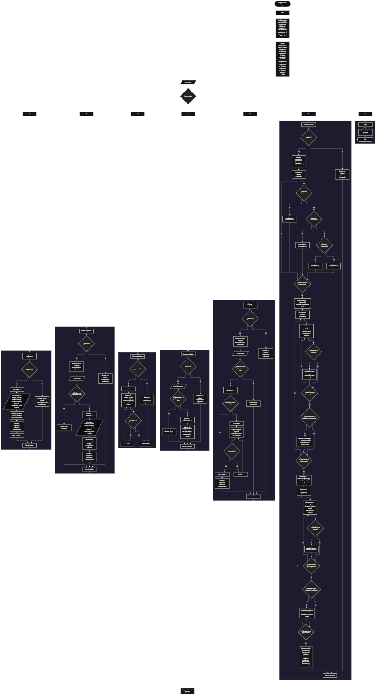

Este proyecto, llamado <b>ampliación de imágenes</b>, fue desarrollado en <b>java</b> como un ejercicio práctico para fortalecer la lógica de programación mediante la creación de un sistema de registro y administración de ampliaciones de imágenes desde la consola. El programa cuenta con un menú principal de siete opciones que permite <b>registrar, editar, listar, buscar, eliminar y mostrar un resumen</b> de las ampliaciones almacenadas. Cada registro contiene información como el nombre de la imagen, su formato, el tamaño original, el tamaño ampliado, el factor de ampliación, la fecha y el estado. Para administrar estos datos, se utilizan siete arreglos paralelos de tipo <b>String</b>, con una capacidad máxima de <b>10 registros durante la ejecución</b>. Durante su desarrollo se aplicaron conceptos fundamentales de programación, como variables, arreglos, estructuras condicionales, ciclos repetitivos y estructuras de selección, además de procedimientos para recorrer, modificar, buscar, eliminar y contabilizar información. Este proyecto permite poner en práctica los conocimientos adquiridos en java y sirve como base para desarrollar sistemas de gestión más avanzados utilizando otros lenguajes y tecnologías.

<h2 align="center">⚙️ Funcionamiento del menú principal</h2>

### ➕ Registrar ampliación

La opción <b>1) registrar ampliación</b> permite almacenar una nueva ampliación de imagen. Antes de solicitar los datos, el programa comprueba si se alcanzó la capacidad máxima de los arreglos mediante la condición <b>total &gt;= imagenes.length</b>. Si no existe espacio disponible, muestra el mensaje <b>"No hay espacio para registrar mas ampliaciones."</b> y finaliza esa operación mediante la instrucción <b>break</b>. Si todavía hay espacio, calcula el identificador utilizando la variable <b>id</b> y la expresión <b>total + 1</b>. Después, solicita el nombre de la imagen, el formato, el tamaño original, el tamaño ampliado, el factor de ampliación, la fecha y el estado. Cada dato se almacena en su respectivo arreglo utilizando la posición indicada por <b>total</b>. Finalmente, muestra el mensaje <b>"Ampliacion registrada correctamente."</b> y aumenta la variable <b>total</b> en uno mediante <b>total++</b>, actualizando así la cantidad de ampliaciones registradas.

### ✏️ Editar ampliación

La opción <b>2) editar ampliación</b> permite modificar los datos de una ampliación registrada. Primero, el programa comprueba si la variable <b>total</b> es igual a <b>0</b>. Si no existen ampliaciones registradas, muestra el mensaje <b>"No existen ampliaciones registradas."</b> y finaliza la operación. En caso contrario, presenta los datos de todos los registros mediante un ciclo <b>for</b>, mostrando el identificador, la imagen, el formato, el tamaño original, el tamaño ampliado, el factor, la fecha y el estado. Después, solicita el identificador mediante la variable <b>idEditar</b> y comprueba que se encuentre dentro del rango permitido utilizando la condición <b>idEditar &gt;= 1 &amp;&amp; idEditar &lt;= total</b>. Si el identificador es válido, calcula la posición correspondiente mediante <b>idEditar - 1</b> y solicita nuevamente los siete datos de la ampliación. Los valores introducidos reemplazan directamente la información anterior en los arreglos correspondientes. Finalmente, muestra el mensaje <b>"Ampliacion actualizada correctamente."</b>. Si el identificador no corresponde a un registro existente, presenta el mensaje <b>"ID no encontrada."</b>.

### 📋 Listar ampliaciones

La opción <b>3) listar ampliaciones</b> permite visualizar todos los registros almacenados en el programa. Primero, comprueba si la variable <b>total</b> es igual a <b>0</b>. Si no existen ampliaciones registradas, muestra el mensaje <b>"No existen ampliaciones registradas."</b>. En caso contrario, presenta el título <b>"Lista de ampliaciones de imagenes"</b> y utiliza un ciclo <b>for</b> para recorrer las posiciones de los arreglos desde <b>0</b> hasta <b>total - 1</b>. Durante cada repetición, muestra el identificador calculado mediante <b>i + 1</b> y los datos almacenados en los siete arreglos: nombre de la imagen, formato, tamaño original, tamaño ampliado, factor de ampliación, fecha y estado. Esta operación permite consultar todos los registros existentes sin necesidad de seleccionar individualmente cada ampliación.

### 🔎 Buscar ampliación

La opción <b>4) buscar ampliación</b> permite localizar un registro mediante su identificador. Primero, el programa comprueba si existen ampliaciones registradas utilizando la condición <b>total == 0</b>. Si no hay registros, muestra el mensaje <b>"No existen ampliaciones registradas."</b> y finaliza la operación. Si existen datos, presenta el título <b>"busqueda de ampliacion"</b> y solicita el identificador mediante la variable <b>idBusqueda</b>. Después, verifica que el valor introducido se encuentre dentro del rango de registros disponibles mediante la condición <b>idBusqueda &gt;= 1 &amp;&amp; idBusqueda &lt;= total</b>. Si la condición se cumple, calcula la posición con <b>idBusqueda - 1</b> y muestra la información completa de la ampliación encontrada. Si el identificador no se encuentra dentro del rango permitido, presenta el mensaje <b>"ID no encontrada."</b>. Esta búsqueda se realiza mediante el número del registro y no mediante el nombre de la imagen.

### 🗑️ Eliminar ampliación

La opción <b>5) eliminar ampliación</b> permite retirar un registro de los arreglos mediante su identificador. Antes de comenzar, el programa comprueba si la variable <b>total</b> es igual a <b>0</b>. Si no existen ampliaciones registradas, muestra el mensaje <b>"No existen ampliaciones registradas."</b> y finaliza la operación. En caso contrario, presenta los datos de las ampliaciones mediante un ciclo <b>for</b> para que el usuario pueda identificar el registro que desea eliminar. Después, solicita el identificador mediante la variable <b>idEliminar</b> y comprueba que se encuentre dentro del rango válido utilizando la condición <b>idEliminar &gt;= 1 &amp;&amp; idEliminar &lt;= total</b>. Si el identificador es válido, obtiene su posición mediante <b>idEliminar - 1</b>. A continuación, utiliza un ciclo <b>for</b> que comienza en la posición seleccionada y continúa mientras <b>i &lt; total - 1</b>. Durante este recorrido, copia los datos de la posición siguiente sobre la posición actual en los siete arreglos: <b>imagenes, formatos, tamanosOriginales, tamanosAmpliados, factoresAmpliacion, fechas y estados</b>. Finalmente, disminuye la variable <b>total</b> mediante <b>total--</b> y muestra el mensaje <b>"Ampliacion eliminada correctamente."</b>. Si el identificador no corresponde a un registro existente, presenta el mensaje <b>"ID no encontrada."</b>.

### 📊 Mostrar resumen

La opción <b>6) mostrar resumen</b> permite obtener información general sobre las ampliaciones almacenadas. Primero, comprueba si existen registros mediante la condición <b>total == 0</b>. Si no hay información disponible, muestra el mensaje <b>"No existen ampliaciones registradas."</b> y finaliza la operación. Si existen registros, inicializa cuatro contadores en cero: <b>pendientes, procesadas, canceladas y otrosEstados</b>. Después, utiliza un ciclo <b>for</b> para recorrer el arreglo <b>estados</b> y clasificar cada registro mediante las estructuras condicionales <b>if, else if y else</b>. Para realizar las comparaciones utiliza el método <b>equalsIgnoreCase()</b>, que permite reconocer los estados <b>"Pendiente", "Procesada" y "Cancelada"</b> sin distinguir entre mayúsculas y minúsculas. Los valores que no coinciden con esos tres estados se contabilizan en <b>otrosEstados</b>. Posteriormente, identifica el formato más utilizado mediante las variables <b>formatoMayor, cantidadFormatoMayor y cantidadFormato</b>, utilizando dos ciclos <b>for</b> anidados para contar las apariciones de cada formato. Realiza un procedimiento equivalente para identificar el factor de ampliación más utilizado mediante <b>factorMayor, cantidadFactorMayor y cantidadFactor</b>. Finalmente, muestra el total de ampliaciones registradas, el formato más utilizado, el factor de ampliación más utilizado y las cantidades correspondientes a cada categoría de estado.

### 🚪 Salir del menú principal

La opción <b>7) salir</b> permite finalizar la ejecución del programa. Cuando el usuario selecciona esta opción, el bloque <b>case 7</b> muestra el mensaje <b>"Gracias por utilizar Ampliacion de Imagenes."</b> y termina el bloque correspondiente mediante <b>break</b>. El menú principal está controlado por una estructura repetitiva <b>do ... while</b>, cuya condición es <b>opcion != 7</b>. Por lo tanto, cuando se selecciona el número 7, la condición deja de cumplirse y el ciclo finaliza. Después, se ejecuta <b>entrada.close()</b> para cerrar el objeto <b>Scanner</b> utilizado durante la lectura de datos.

<h2 align="center">🧠 Temas aplicados en el proyecto</h2>

### 📦 Variables

En este proyecto se utilizan variables para controlar la cantidad de ampliaciones almacenadas, guardar la opción seleccionada en el menú, identificar los registros que se desean modificar, buscar o eliminar y contabilizar los estados, formatos y factores de ampliación. También se utilizan variables de control para recorrer los arreglos y calcular las frecuencias de los valores registrados. Cada variable cumple una función específica dentro de las operaciones del programa.

🔢 **opcion:** Almacena el número de la opción seleccionada por el usuario en el menú principal.

📊 **total:** Controla la cantidad de ampliaciones registradas y determina las posiciones ocupadas de los arreglos.

🆔 **id:** Calcula el identificador de una nueva ampliación mediante la expresión <b>total + 1</b>.

✏️ **idEditar:** Almacena el identificador de la ampliación que se desea modificar.

🔎 **idBusqueda:** Almacena el identificador introducido para buscar una ampliación.

🗑️ **idEliminar:** Almacena el identificador de la ampliación que se desea eliminar.

📍 **posicion:** Identifica la posición del registro dentro de los arreglos mediante la resta de uno al identificador seleccionado.

🔄 **i:** Funciona como contador en los ciclos <b>for</b> utilizados para recorrer los registros y realizar los desplazamientos durante la eliminación.

🔁 **j:** Funciona como contador del ciclo interno utilizado para comparar los formatos y factores de ampliación durante el cálculo de sus frecuencias.

📌 **pendientes:** Contabiliza la cantidad de ampliaciones cuyo estado es <b>"Pendiente"</b>.

✅ **procesadas:** Contabiliza la cantidad de ampliaciones cuyo estado es <b>"Procesada"</b>.

❌ **canceladas:** Contabiliza la cantidad de ampliaciones cuyo estado es <b>"Cancelada"</b>.

📊 **otrosEstados:** Contabiliza los registros cuyos estados no coinciden con las tres categorías principales.

📁 **formatoMayor:** Almacena el formato que presenta la mayor cantidad de apariciones.

🔢 **cantidadFormato:** Cuenta las apariciones de un formato durante el recorrido de los arreglos.

📈 **cantidadFormatoMayor:** Almacena la mayor cantidad de apariciones encontrada entre los formatos.

⚙️ **factorMayor:** Almacena el factor de ampliación que presenta la mayor cantidad de apariciones.

🔢 **cantidadFactor:** Cuenta las apariciones de un factor de ampliación durante el recorrido de los arreglos.

📈 **cantidadFactorMayor:** Almacena la mayor cantidad de apariciones encontrada entre los factores de ampliación.

⌨️ **entrada:** Objeto de la clase <b>Scanner</b> que permite recibir los datos introducidos por el usuario mediante la consola.

### 🗃️ Arreglos

En este proyecto se utilizan siete arreglos paralelos de tipo <b>String</b>, cada uno con una capacidad de <b>10 posiciones</b>. Estos arreglos permiten almacenar los diferentes datos relacionados con cada ampliación de imagen. Todos utilizan el mismo índice para representar la información de un mismo registro. Por ejemplo, los datos almacenados en la posición <b>0</b> corresponden a una misma ampliación y se encuentran distribuidos entre <b>imagenes[0], formatos[0], tamanosOriginales[0], tamanosAmpliados[0], factoresAmpliacion[0], fechas[0] y estados[0]</b>. Esta organización permite administrar los registros mediante posiciones relacionadas, facilitando las operaciones de registro, edición, búsqueda, consulta y eliminación.

🖼️ **imagenes[10]:** Almacena los nombres de las imágenes registradas.

📁 **formatos[10]:** Almacena los formatos correspondientes a cada imagen.

📏 **tamanosOriginales[10]:** Almacena los tamaños originales de las imágenes.

📐 **tamanosAmpliados[10]:** Almacena los tamaños ampliados de las imágenes.

⚙️ **factoresAmpliacion[10]:** Almacena los factores de ampliación introducidos para cada registro.

📅 **fechas[10]:** Almacena las fechas correspondientes a las ampliaciones.

📊 **estados[10]:** Almacena los estados de las ampliaciones registradas.

### 🔀 Estructuras condicionales

En este proyecto se utilizan las estructuras <b>if, else if y else</b> para comprobar las condiciones necesarias antes de ejecutar las operaciones del programa. Se utilizan para verificar si existen registros almacenados, comprobar si los arreglos alcanzaron su capacidad máxima, validar los identificadores introducidos para editar, buscar o eliminar ampliaciones y clasificar los estados durante la generación del resumen. También permiten determinar si un formato o factor de ampliación supera la frecuencia máxima encontrada hasta el momento. Estas condiciones hacen posible que el programa ejecute diferentes instrucciones dependiendo de los datos almacenados y de las selecciones realizadas por el usuario.

### 🔄 Estructuras repetitivas

En este proyecto se utilizan los ciclos <b>for</b> y <b>do ... while</b> para controlar los recorridos y mantener activo el menú principal. Los ciclos <b>for</b> permiten recorrer los arreglos para mostrar los registros, consultar sus datos y contabilizar los estados. También se utilizan para desplazar los valores de los arreglos durante la eliminación de una ampliación. En la opción de resumen, se implementan ciclos <b>for</b> anidados para comparar los formatos y factores de ampliación y calcular cuántas veces aparece cada valor. Por otro lado, el ciclo <b>do ... while</b> permite repetir el menú principal mientras la opción seleccionada sea diferente de <b>7</b>, manteniendo el programa en funcionamiento hasta que el usuario decida salir.

### 🎯 Estructura switch

El programa utiliza la estructura <b>switch</b> para evaluar el contenido de la variable <b>opcion</b> y ejecutar las instrucciones correspondientes a cada selección del usuario. Cada bloque <b>case</b> representa una operación específica del sistema: <b>registrar ampliación, editar ampliación, listar ampliaciones, buscar ampliación, eliminar ampliación, mostrar resumen y salir</b>. Además, se utiliza el bloque <b>default</b> para mostrar el mensaje <b>"Opcion no valida."</b> cuando el usuario introduce un número que no corresponde a ninguna de las opciones disponibles. La instrucción <b>break</b> permite finalizar la ejecución del caso seleccionado y continuar con el funcionamiento del menú.

### 🔢 Dimensionamiento de arreglos

En este proyecto se utiliza la declaración de arreglos mediante la instrucción <b>new String[10]</b> para establecer una capacidad fija de almacenamiento. Se definen siete arreglos, cada uno con <b>10 posiciones</b>, destinados a guardar los datos de las ampliaciones de imágenes. La variable <b>total</b> controla la cantidad de registros almacenados y permite identificar la siguiente posición disponible. Además, se utiliza la propiedad <b>imagenes.length</b> para consultar la capacidad del arreglo y comprobar si todavía es posible registrar otra ampliación. De esta manera, el programa administra únicamente las posiciones comprendidas entre <b>0</b> y <b>total - 1</b>.

### 🔄 Reorganización de registros

Cuando el usuario elimina una ampliación, el programa reorganiza los datos de los arreglos para mantener consecutivos los registros que permanecen almacenados. Para realizar este procedimiento, calcula la posición que se desea eliminar mediante <b>idEliminar - 1</b> y utiliza un ciclo <b>for</b> que comienza en esa posición y continúa mientras <b>i &lt; total - 1</b>. En cada repetición, copia el contenido de la posición siguiente sobre la posición actual en los siete arreglos paralelos. De esta forma, los datos de la ampliación siguiente ocupan el espacio del registro eliminado. Finalmente, disminuye la variable <b>total</b> en uno para actualizar la cantidad de registros activos. El programa no realiza una limpieza explícita de la última posición después del desplazamiento, pero esta queda fuera del rango controlado por <b>total</b> y no se utiliza en las operaciones normales de consulta.

<h2 align="center">¿Cómo se implementaron las operaciones crud en el proyecto?</h2>

Las operaciones <b>crud</b> se implementaron mediante las diferentes opciones del menú principal, permitiendo administrar la información de las ampliaciones de imágenes. La operación <b>crear</b> corresponde a <b>registrar ampliación</b>, donde se solicitan y almacenan los siete datos de una nueva imagen; <b>leer</b> se realiza mediante las opciones <b>listar ampliaciones, buscar ampliación y mostrar resumen</b>, que permiten consultar los registros y obtener información sobre los estados, formatos y factores más utilizados; <b>actualizar</b> corresponde a <b>editar ampliación</b>, donde se reemplazan los datos de un registro existente; y <b>eliminar</b> se realiza mediante la opción <b>eliminar ampliación</b>, que desplaza los datos posteriores y disminuye la cantidad de registros almacenados. Estas operaciones utilizan los siete arreglos paralelos, la variable <b>total</b>, estructuras condicionales y ciclos repetitivos para administrar la información durante la ejecución del programa.

<h2 align="center">Diagrama de flujo del proyecto</h2>

<h2 align="center">🛡️ Validaciones del programa</h2>

### 📭 No existen ampliaciones registradas

Esta comprobación se utiliza en las opciones de <b>editar, listar, buscar, eliminar y mostrar resumen</b>. El programa verifica si la variable <b>total</b> es igual a <b>0</b>. Cuando no existen ampliaciones registradas, muestra el mensaje <b>"No existen ampliaciones registradas."</b>. En las opciones de edición, búsqueda, eliminación y resumen, también utiliza la instrucción <b>break</b> para evitar que se ejecuten las instrucciones posteriores de la operación cuando no hay datos disponibles.

### ⚠️ Capacidad máxima de registros

Esta comprobación se utiliza en la opción <b>registrar ampliación</b> para evitar almacenar más datos de los que permiten los arreglos. El programa compara la variable <b>total</b> con la capacidad del arreglo mediante la condición <b>total &gt;= imagenes.length</b>. Si la cantidad de registros alcanza las 10 posiciones disponibles, muestra el mensaje <b>"No hay espacio para registrar mas ampliaciones."</b> y utiliza <b>break</b> para impedir que continúe el proceso de registro.

### ❌ Identificador no encontrado

Esta comprobación se utiliza en las opciones de <b>editar, buscar y eliminar ampliación</b>. El programa verifica que el identificador introducido sea mayor o igual a <b>1</b> y menor o igual a la cantidad de registros almacenados, mediante condiciones como <b>idEditar &gt;= 1 &amp;&amp; idEditar &lt;= total</b>. Cuando el identificador se encuentra dentro del rango permitido, calcula la posición correspondiente restando uno al valor introducido. Si el identificador no corresponde a una posición ocupada, muestra el mensaje <b>"ID no encontrada."</b> e impide realizar la operación solicitada.

### 📊 Clasificación de estados

Esta comprobación se utiliza en la opción <b>mostrar resumen</b> para clasificar los registros de acuerdo con el contenido del arreglo <b>estados</b>. El programa utiliza el método <b>equalsIgnoreCase()</b> para comparar cada valor con los estados <b>"Pendiente", "Procesada" y "Cancelada"</b>, sin diferenciar entre letras mayúsculas y minúsculas. Si el valor coincide con alguno de estos estados, aumenta el contador correspondiente. Cuando no coincide con ninguno, aumenta la variable <b>otrosEstados</b>. Así, el programa también contabiliza los registros que contienen estados diferentes de las tres categorías principales.

### ⚠️ Opción no válida

La estructura <b>switch</b> incluye el bloque <b>default</b>, que se ejecuta cuando el usuario introduce un número diferente de las opciones comprendidas entre <b>1 y 7</b>. En ese caso, muestra el mensaje <b>"Opcion no valida."</b> y permite que el ciclo <b>do ... while</b> vuelva a presentar el menú principal, siempre que la opción introducida sea diferente de <b>7</b>.

### 🔢 Entrada de identificadores y opciones

El programa utiliza el método <b>nextInt()</b> para recibir la opción del menú y los identificadores utilizados durante las operaciones de edición, búsqueda y eliminación. Después de cada lectura numérica, utiliza <b>nextLine()</b> para consumir el salto de línea pendiente y permitir que las siguientes lecturas de texto funcionen correctamente. Sin embargo, el código no incluye un tratamiento de excepciones para las entradas que no sean números enteros. Si se introduce texto en una lectura realizada mediante <b>nextInt()</b>, puede producirse una excepción <b>InputMismatchException</b> y detenerse la ejecución.

### 📝 Almacenamiento de datos

Los datos de las ampliaciones se almacenan en arreglos de tipo <b>String</b>, por lo que los tamaños originales, los tamaños ampliados y los factores de ampliación se guardan como texto. El programa no realiza operaciones matemáticas para calcular el tamaño ampliado ni comprueba que el factor introducido corresponda a los tamaños registrados. Tampoco contiene validaciones que impidan introducir campos vacíos o fechas y formatos con cualquier contenido. Además, la información se conserva únicamente en los arreglos durante la ejecución del programa, ya que no se implementa almacenamiento permanente mediante archivos o bases de datos.

### 🔄 Identificadores de los registros

El programa genera los identificadores utilizando la posición que ocupa cada ampliación dentro de los arreglos. Durante el registro, utiliza la expresión <b>total + 1</b> para calcular el identificador, mientras que en las operaciones de edición, búsqueda y eliminación utiliza <b>id - 1</b> para obtener la posición correspondiente. Debido a este procedimiento, los identificadores dependen del orden de los registros. Cuando se elimina una ampliación, los datos posteriores se desplazan hacia posiciones anteriores y los identificadores que se muestran pueden cambiar.

<h2 align="center">🎯 Objetivo del proyecto</h2>

El objetivo principal de este proyecto es fortalecer la <b>lógica de programación</b> mediante el desarrollo de un sistema de administración de ampliaciones de imágenes en <b>java</b>. A través de su construcción se busca aplicar los conocimientos adquiridos sobre variables, arreglos paralelos, estructuras condicionales, ciclos repetitivos y estructuras de selección, integrándolos para resolver un problema de manera organizada. Además, el proyecto permite comprender cómo registrar, consultar, modificar y eliminar información, así como generar resúmenes mediante el conteo de estados y la identificación de los formatos y factores de ampliación más utilizados. De esta manera, se establece una base para desarrollar sistemas de gestión más completos utilizando otros lenguajes y tecnologías.

